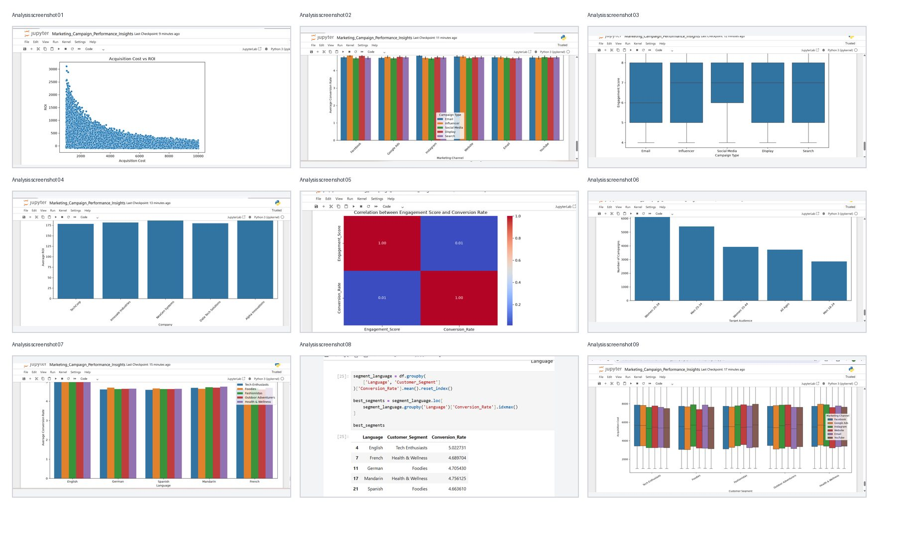
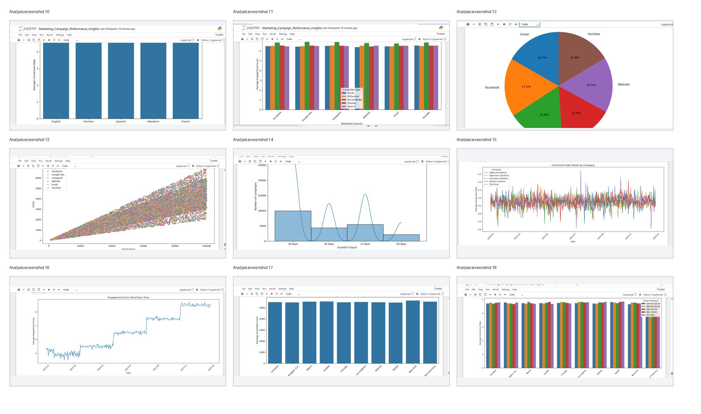

# Marketing Campaign Performance Insights

<p align="center">
  <strong>Turning campaign data into practical marketing decisions</strong><br/>
  Python · Pandas · NumPy · Matplotlib · Seaborn
</p>

<p align="center">
  
  
  
  
</p>

## Executive summary

This analysis reviews 22,029 campaign records to identify patterns in conversion, ROI, acquisition cost, and engagement. The results show that engagement is not a dependable stand-alone indicator of conversion (correlation approximately 0.01), while performance varies across audiences, languages, channels, and locations. The practical business takeaway is to assess campaigns using outcome measures together, then refine targeting and budget decisions using segment- and location-level evidence.

## Project overview

This project analyzes **22,029 marketing campaign records across 16 columns** to understand how campaign type, channel, audience, language, time, and location relate to marketing performance. The analysis focuses on conversion rate, acquisition cost, return on investment (ROI), and engagement.

The goal is not just to create charts, but to translate the analysis into clear findings and practical recommendations that can support campaign planning and budget decisions.

## Business questions

- How do acquisition cost and ROI vary across campaigns?
- Which channels and campaign types show stronger conversion and engagement?
- How does performance differ by customer segment, target audience, and language?
- What patterns appear across campaign dates and locations?
- How can the findings inform future campaign optimization?

## Analysis workflow

1. **Load and inspect** the dataset with Pandas.
2. **Profile the data** using dimensions, data types, descriptive statistics, unique values, and category counts.
3. **Explore campaign performance** across conversion rate, acquisition cost, ROI, and engagement.
4. **Compare customer groups and channels** by segment, target audience, language, and channel.
5. **Study time and geography** using date-based and location-based visualizations.
6. **Translate findings into recommendations** for campaign evaluation and optimization.

## Tools and techniques

| Area | Methods |
|---|---|
| Data handling | Python, Pandas, NumPy |
| Exploratory analysis | Summary statistics, grouping, aggregation, correlation |
| Visualization | Matplotlib, Seaborn |
| Analysis dimensions | Campaign, channel, audience, segment, language, date, location |
| Deliverables | Jupyter Notebook, HTML notebook export, chart gallery, business insights and recommendations |

## Selected findings

- The relationship between **Engagement Score** and **Conversion Rate** is very weak in this dataset (correlation approximately **0.01**). Engagement alone should therefore not be treated as a reliable indicator of conversion.
- Average conversion rates are relatively close across the channels and campaign types examined.
- Social Media campaigns show comparatively strong engagement across several channels.
- Average conversion rate differs by language; English has the highest average in the analyzed dataset (approximately **5.01**).
- The acquisition-cost versus ROI scatter plot shows a wide spread: higher acquisition-cost campaigns have a lower upper range of ROI, so cost should be assessed alongside campaign outcomes rather than in isolation.
- ROI contribution is distributed across the ten locations, with individual location shares in a relatively narrow range.

## Business recommendations

1. Evaluate campaigns using **ROI and conversion rate together**, rather than relying on engagement metrics alone.
2. Continue monitoring Social Media engagement while validating whether it translates into business outcomes.
3. Identify stronger-performing audience and customer-segment combinations and use them to guide targeted campaigns.
4. Compare acquisition costs and ROI across locations before reallocating marketing budgets.
5. Review campaign performance regularly and optimize campaigns based on measurable outcomes.

## Explore the deliverables

| File | What it contains |
|---|---|
| [Jupyter Notebook](./Marketing_Campaign_Performance_Insights.ipynb) | Complete Python analysis, code, outputs, and visualizations |
| [HTML Report](./Marketing_Campaign_Performance_Insights.html) | Browser-friendly notebook export with rendered analysis and charts |

### Visual chart gallery

The gallery below provides a quick visual overview of the analysis. Open either image to view it at full size.

<p align="center">
  <a href="./campaign-analysis-gallery-1.jpg"></a>
  <a href="./campaign-analysis-gallery-2.jpg"></a>
</p>

For the complete notebook outputs and visualizations, open the [HTML report](./Marketing_Campaign_Performance_Insights.html).

## Documentation

- [Data Dictionary and Analysis Methodology](./docs/DATA_DICTIONARY_AND_METHODOLOGY.md) — field descriptions, analysis workflow, and interpretation limitations.

## Repository structure

```text
Marketing-Campaign-Performance-Insights/
├── README.md
├── requirements.txt
├── Marketing_Campaign_Performance_Insights.ipynb
├── Marketing_Campaign_Performance_Insights.html
├── campaign-analysis-gallery-1.jpg
└── campaign-analysis-gallery-2.jpg
```

## Dataset

- **Source:** [Marketing Campaign Dataset](https://raw.githubusercontent.com/ArchanaInsights/Datasets/main/marketing_campaign.csv)
- **Records:** 22,029
- **Columns:** 16
- **Coverage:** campaign details, customer/audience attributes, channels, performance metrics, date, and location.

The dataset is used for educational and portfolio analysis. Interpretations describe patterns in this dataset and should not be treated as proof of causation.

## Run the notebook locally

1. Clone this repository:
   ```bash
   git clone https://github.com/shanmukhkoyya/Marketing-Campaign-Performance-Insights.git
   cd Marketing-Campaign-Performance-Insights
   ```
2. Install the required libraries from the dependency file:
   ```bash
   pip install -r requirements.txt
   ```
3. Launch Jupyter:
   ```bash
   jupyter notebook
   ```
4. Open `Marketing_Campaign_Performance_Insights.ipynb` and run the cells.

The notebook reads the dataset from the public CSV source linked above, so an internet connection is required when running the data-loading cell.

## About

**Shanmukh Koyya**  
Data Analytics | Python · SQL · Power BI

- Email: [shanmukhkoyya1234@gmail.com](mailto:shanmukhkoyya1234@gmail.com)
- LinkedIn: [linkedin.com/in/shanmukh-koyya](https://www.linkedin.com/in/shanmukh-koyya/)
- GitHub: [github.com/shanmukhkoyya](https://github.com/shanmukhkoyya)

---

<p align="center"><sub>Built as a practical data analytics portfolio project · Focused on evidence-led business insights</sub></p>
